<div align="center">

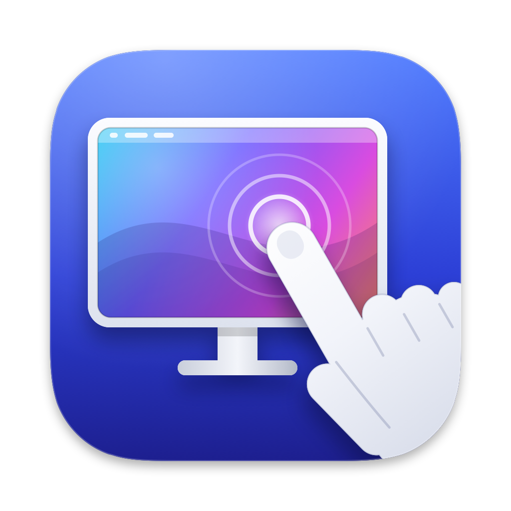

# TouchMyMac

**Touch for every Mac, not just the new MacBook Pro.**

**English** · [简体中文](README.zh-CN.md)

[](https://github.com/jinghuichen/touchMyMac/releases/latest)
[](https://github.com/jinghuichen/touchMyMac/releases)
[](#-install)
[](#-install)
[](LICENSE)
[](https://github.com/jinghuichen/touchMyMac/stargazers)
[](https://github.com/jinghuichen/touchMyMac/commits/main)

[**Download**](https://github.com/jinghuichen/touchMyMac/releases/latest) · [Gestures](#-gestures) · [Install](#-install) · [FAQ](#-faq) · [Build](#-build-from-source)

</div>

<p align="center">
<picture>
  <source media="(prefers-color-scheme: dark)" srcset="docs/images/hero-en-dark.svg">
  
</picture>
</p>

TouchMyMac turns an external USB touchscreen into a real macOS input device. It reads raw HID touch data in user space and turns it into clicks, scrolling with inertia, dragging, multi-finger gestures, shortcut triggers and an on-screen keyboard, so the display feels less like a mouse emulator and more like an iPad.

## 🍎 Touch beyond the new MacBook Pro

In October 2026 Apple announced the first Mac with a touchscreen: a MacBook Pro whose OLED display has touch built in. That touch belongs to the laptop's own screen. TouchMyMac brings the same kind of interaction to the screens and Macs that don't have it:

| | MacBook Pro with touchscreen | TouchMyMac |
|---|---|---|
| **Which screen** | Its built-in display | Any USB touchscreen: desktop monitors, portable displays, touch boards |
| **Which Mac** | The new MacBook Pro | Any Mac on macOS 12 or later |
| **Cost** | Comes with the new MacBook Pro | Free and open source |
| **Gestures** | Scrolling, pinch and swiping between pages or desktops | The same, plus a floating keyboard, three- to five-finger gestures, shortcut mappings and tunable scrolling |

## ✨ Highlights

| | |
|---|---|
| 👆 **Direct touch** | Tap to click, drag to scroll, hold to press and drag (a dot shows when the press takes), two-finger tap for a secondary click. Taps, scrolls and long presses are told apart the way Android does it, and fast double and triple taps register. Sliders, scroll bars and title bars follow your finger right away. |
| 🌀 **Trackpad-like scrolling** | Scrolling follows the display's refresh rate, filters out touch jitter and hands over to inertia without a pause. The pointer hides while you scroll. |
| 🖐 **Multi-finger gestures** | Pinch to zoom around your fingers, Mission Control, switching desktops, showing or hiding the keyboard, and configurable shortcuts on four- and five-finger gestures. |
| ⌨️ **Floating keyboard** | A full Mac layout whose keys fire as you touch them, so fast, overlapping typing doesn't drop letters. Switches input sources and shrinks to a mini keyboard. |
| 🔌 **Works with more screens** | Switches touchscreens made for Windows out of single-touch mouse mode, and opens at login so the screen works right away. |
| 🩺 **Status and diagnostics** | The menu bar menu shows whether Accessibility is allowed and which display your touches land on. Settings adds touch counters and a gesture stream to tune noisy panels. |
| 🌐 **English and 简体中文** | The interface follows your system language, or pick one under Settings → General → Language. |
| 🔒 **User space only** | No kernel extension or driver install: one app, one Accessibility permission (some screens also need Input Monitoring). |

## 🖐 Gestures

<table>
<tr><td align="center" width="25%"><picture><source media="(prefers-color-scheme: dark)" srcset="docs/images/gestures/tap-dark.svg">Tap</b> to click"></picture><br><sub><b>Tap</b> to click</sub></td><td align="center" width="25%"><picture><source media="(prefers-color-scheme: dark)" srcset="docs/images/gestures/scroll-dark.svg">Drag</b> to scroll, flick to glide"></picture><br><sub><b>Drag</b> to scroll, flick to glide</sub></td><td align="center" width="25%"><picture><source media="(prefers-color-scheme: dark)" srcset="docs/images/gestures/hold-drag-dark.svg">Hold, then drag</b> to move"></picture><br><sub><b>Hold, then drag</b> to move</sub></td><td align="center" width="25%"><picture><source media="(prefers-color-scheme: dark)" srcset="docs/images/gestures/two-finger-tap-dark.svg">Two-finger tap</b> for a secondary click"></picture><br><sub><b>Two-finger tap</b> for a secondary click</sub></td></tr>
<tr><td align="center" width="25%"><picture><source media="(prefers-color-scheme: dark)" srcset="docs/images/gestures/pinch-dark.svg">Pinch</b> to zoom"></picture><br><sub><b>Pinch</b> to zoom</sub></td><td align="center" width="25%"><picture><source media="(prefers-color-scheme: dark)" srcset="docs/images/gestures/mission-control-dark.svg">Three fingers up</b> for Mission Control"></picture><br><sub><b>Three fingers up</b> for Mission Control</sub></td><td align="center" width="25%"><picture><source media="(prefers-color-scheme: dark)" srcset="docs/images/gestures/desktops-dark.svg">Three fingers left / right</b> to switch desktops"></picture><br><sub><b>Three fingers left / right</b> to switch desktops</sub></td><td align="center" width="25%"><picture><source media="(prefers-color-scheme: dark)" srcset="docs/images/gestures/keyboard-dark.svg">Four fingers up</b> for the keyboard"></picture><br><sub><b>Four fingers up</b> for the keyboard</sub></td></tr>
</table>

| Gesture | Action |
|---|---|
| Tap | Click (tap twice to double-click) |
| Drag with one finger | Scroll, with inertia when you flick |
| Hold still for 0.4 s, then move | Drag (select text, move windows and files); a dot under the finger shows the press |
| Drag a slider, scroll bar, splitter or title bar | Moves it right away, no hold needed |
| Tap with two fingers | Secondary click, like on a Mac trackpad |
| Pinch with two fingers | Zoom around your fingers (Pinch Zoom Speed sets how far) |
| Swipe up with three fingers | Mission Control |
| Swipe left / right with three fingers | Move between desktops and full-screen apps |
| Swipe up / down with four fingers | Show / hide the floating keyboard (also over the keyboard) |
| Swipe left with four fingers | Shortcut sequence (default `cmd+a, delete`) |
| Hold five fingers still | Keep a shortcut pressed (default `fn`) |

## ⌨️ Floating keyboard

<picture>
  <source media="(prefers-color-scheme: dark)" srcset="docs/images/keyboard-dark.png">
  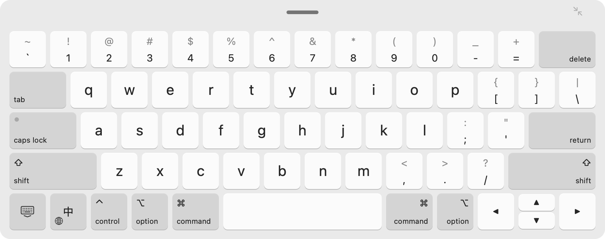
</picture>

- Full Mac (US ANSI) layout with the number row, symbols and arrow keys
- Keys fire as you touch them (within 45 ms, or as soon as you lift), and each finger types its own key, so fast typing doesn't drop letters
- Sticky shift, control, option and command for shortcuts like ⌘C, plus caps lock
- Delete, space and the arrow keys repeat while held
- Floats above every other window; drag it by the handle on top or its empty edge, and it remembers where you put it
- Hide it with the hide key or a four-finger swipe down, which also works with your fingers on the keyboard
- The 🌐 key next to the hide key switches input sources, for example between English and Pinyin. It uses your own shortcut from Keyboard Shortcuts → Input Sources, and its cap shows the current input source
- Shrink it to a mini keyboard (the same layout at 60% size) with the button at the top right; it remembers the size

## 🌀 How scrolling works

Synthesized scroll events are easy to get wrong, so TouchMyMac borrows from how phones and trackpads do it:

- **One step per display frame.** Touch reports (often around 120 Hz) don't line up with display frames, so the finger's path is resampled at each frame instead of posting every report.
- **Jitter filtering.** A One Euro filter smooths heavily at low speed, where touch noise is as large as the movement itself, and barely at high speed, where lag would be noticeable.
- **Release velocity like Android.** A quadratic fit over the last 100 ms, and no fling if the finger had stopped for 40 ms.
- **Continuous handover to inertia.** Inertia starts at the release velocity. If reports pause for a moment, the content keeps gliding instead of stopping.
- **Inertia like Android's fling.** The glide distance and duration come from the release speed and Android's scroll friction, so the content stops at a definite point instead of crawling on.
- **Trackpad scroll phases**, so apps treat the events like trackpad scrolling.

## 👆 How taps work

One finger is told apart the way Android's GestureDetector does it:

- **A possible tap** until the finger moves 6 mm from where it landed (then it scrolls) or stays inside that for the Hold Duration, 0.4 s (then the mouse button goes down where it landed, so moving drags). Lifting a possible tap clicks where the finger landed, however long it took.
- **The slop is wider than on a phone** (Android uses about 1.3 mm) because fingers flatten and roll as they land, which moved the contact point up to 3 mm on the panels we measured.
- **Liftoffs come from the screen.** Many screens report the liftoff without coordinates; TouchMyMac still ends the touch right away, so taps are quick and fast double taps aren't merged into one.
- **Clicks last 40 ms** between button down and up, like a real mouse, so controls show their pressed state and don't drop clicks.
- **Two fingers** pinch once their distance changes by 8 mm, or scroll once the point between them moves 6 mm, whichever comes first. The zoom follows the ratio of finger distances, around the point between them.

## 📦 Install

1. Download `TouchMyMac-x.y.z-macOS-unsigned.zip` from [**Releases**](https://github.com/jinghuichen/touchMyMac/releases/latest), unzip it and move `TouchMyMac.app` to `/Applications`.
2. Open the app. It isn't notarized, so macOS blocks the first launch: open **System Settings → Privacy & Security** and click **Open Anyway**.
3. Grant **Accessibility** access when asked (System Settings → Privacy & Security → Accessibility). TouchMyMac needs it to post clicks, scrolling and key presses. Some touchscreens can only be read with **Input Monitoring** as well; TouchMyMac asks for it only when your screen needs it, and the menu bar menu then shows an Input Monitoring row.
4. Connect your touchscreen. TouchMyMac maps touches to an external display, never the Mac's built-in one. With several external displays, check the **Touchscreen** row in the menu bar menu and pick the right monitor there.

> [!IMPORTANT]
> Release builds are ad-hoc signed, so macOS treats every update as a new app. After updating, **remove TouchMyMac from the Accessibility list (and Input Monitoring, if you use it) and add it again**. Otherwise touches do nothing even though the switch looks on.

> [!NOTE]
> The release zip is built for Apple silicon. Intel Macs can [build from source](#-build-from-source), but that is untested.

## ⚙️ Settings

Everything below lives in the Settings window (menu bar icon → Settings).

| Setting | Default | What it does |
|---|---|---|
| Open at Login | Off | Start TouchMyMac when you log in (macOS 13 or later) |
| Drag Controls Directly | On | Sliders, scroll bars, dividers, title bars, window edges and windows in Mission Control follow your finger right away; elsewhere, dragging scrolls |
| Small Target Assist | On | A finger a little beside a divider, a window edge or corner, or a window's close, minimize or zoom button still gets it; the top of a window drags it in apps without a reported title bar; Mission Control shows desktop close buttons under your finger |
| Hold Duration | 0.4 s | How long a finger holds still before the mouse button goes down, so moving drags instead of scrolling |
| Scroll Speed | 1.0 | Content movement per finger movement; 1.0 keeps the content under your finger |
| Hide Pointer While Scrolling | On | Hide the pointer while your finger scrolls |
| Scroll Inertia | On | Keep scrolling after a flick |
| Decay Speed | 0.92 | How quickly inertia slows down (higher glides longer) |
| Inertia Amount | 1.0 | How far inertia glides |
| Pinch Zoom Speed | 1.5 | How far a pinch zooms; 1.0 follows the fingers exactly |
| Double Click Zone | 8 mm | How close two taps must be to count as a double click |
| Error Resistance | 4 | Reports to wait before dropping a touch on panels that lose contacts |
| Ignore Origin Touches | On | Ignore bogus touches at (0, 0) that some panels send |
| Secondary Click / Magnification / Mission Control / Desktops / Keyboard | On | Turn individual gestures on or off |
| Five-Finger Hold Shortcut | `fn` | Chord held while five fingers rest on the screen |
| Four-Finger Left Swipe Sequence | `cmd+a, delete` | Shortcuts fired by a four-finger left swipe |

<picture>
  <source media="(prefers-color-scheme: dark)" srcset="docs/images/settings-dark.png">
  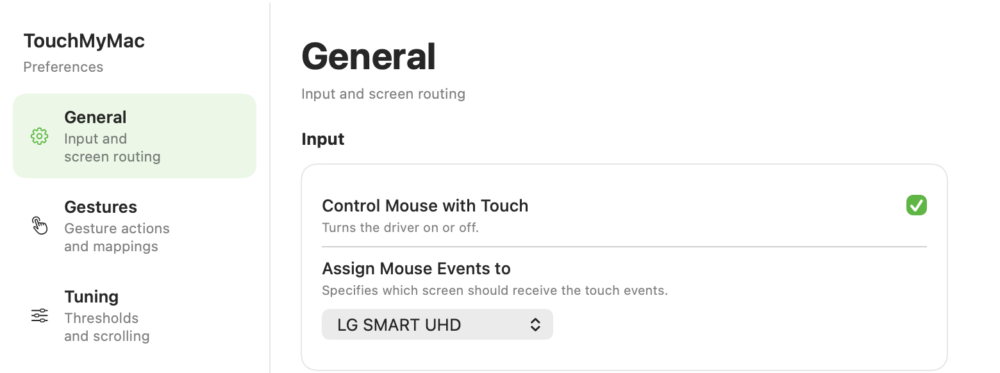
</picture>

## 🖥 Tested hardware

| Display | Status |
|---|---|
| LG Smart Monitor Swing | ✅ Tested by this fork |
| ELAN panels, LG CreateBoard | 🧪 Worked with contributors' patches ([#2](https://github.com/jinghuichen/touchMyMac/pull/2), [#3](https://github.com/jinghuichen/touchMyMac/pull/3)); those fixes are in 1.5.0 but not confirmed there yet |
| Other USB HID touchscreens | ❔ Should work if they work on Windows without a driver; not validated yet |

Have it working on another screen? Open an issue or PR to add it here.

## ❓ FAQ

<details>
<summary><b>Touches do nothing after installing or updating</b></summary>

Accessibility or Input Monitoring access is missing or stale. The menu bar menu then shows **Not Allowed** next to it; clicking it opens the right page. Remove TouchMyMac from that list in System Settings → Privacy & Security, add `/Applications/TouchMyMac.app` again, then quit and reopen the app.
</details>

<details>
<summary><b>macOS says the app is damaged or can't be opened</b></summary>

The build isn't notarized. Use **Open Anyway** in System Settings → Privacy & Security. If macOS still refuses, clear the download quarantine flag:

```bash
xattr -dr com.apple.quarantine /Applications/TouchMyMac.app
```
</details>

<details>
<summary><b>Dragging selects or moves things when I meant to scroll</b></summary>

Pausing longer than the Hold Duration before you move starts a drag. Start moving sooner, or raise Hold Duration in Settings → Tuning.

Sliders, scroll bars, dividers, window title bars and window edges move as soon as you drag them. In Mission Control, windows move as soon as you drag them too. With Small Target Assist (on by default), a finger that lands a little beside a divider, a window edge or a window's close, minimize or zoom button still gets it, and tapping a desktop's close button in Mission Control works even though the button only shows on hover. If you'd rather scroll everywhere, turn off Drag Controls Directly in Settings → Gestures.
</details>

<details>
<summary><b>A slider or fader scrolls the page instead of moving</b></summary>

TouchMyMac asks macOS Accessibility what is under your finger. Apps that draw their own controls, such as the faders in some audio apps, don't tell macOS that a control is there, so a drag there scrolls. Hold your finger still for a moment (the Hold Duration), then move it.
</details>

<details>
<summary><b>Touches land on the wrong display</b></summary>

Open the menu bar menu, point to **Touchscreen** and pick the monitor (or use Settings → General → Assign Mouse Events to). TouchMyMac remembers the choice. Choose **Automatic** to let it pick again: it skips the Mac's built-in display, but with several external displays it can only guess.
</details>

<details>
<summary><b>Taps land in the wrong place and multi-finger gestures do nothing</b></summary>

TouchMyMac isn't receiving touches, so macOS treats the screen as a plain mouse that maps onto whichever display it picks. If the menu bar menu shows **Input Monitoring: Not Allowed**, allow it: some screens can't be read without that permission, and Settings → Diagnostics then shows Touch Reports staying at 0.
</details>

<details>
<summary><b>Touches only move the pointer, on whichever display it's on</b></summary>

Many touchscreens made for Windows start as a single-touch mouse until the computer switches them to multi-touch. TouchMyMac now does that when the screen connects, the way Windows does. If touches still only move the pointer, unplug the screen's USB cable and plug it back in. If that doesn't help, open an issue with the output of `hidutil list`.
</details>

<details>
<summary><b>Input is jumpy or touches get stuck</b></summary>

Raise Error Resistance and keep Ignore Origin Touches on. The Diagnostics pane shows live touch counts and the recognized gestures, which helps narrow it down.
</details>

<details>
<summary><b>How do I switch the app between English and Chinese?</b></summary>

Pick it under **Settings → General → Language** and click Restart Now. The default, System Default, follows your system: Simplified Chinese if it comes first in System Settings → General → Language & Region, English otherwise.
</details>

## 🛠 Build from source

```bash
git clone https://github.com/jinghuichen/touchMyMac.git
cd touchMyMac
open TouchMyMac.xcodeproj
```

Or build, install to `/Applications` and launch in one step:

```bash
scripts/build_install_run.sh
```

Requires Xcode and macOS 12 or later.

## 🗂 Project structure

```
TouchMyMac/   App: settings UI, menu bar item, diagnostics, floating keyboard
Core/         TouchUpCore: HID parsing, touch tracking, gestures, event posting
scripts/      Build-and-install helper
docs/         README images
```

## 🧭 Roadmap

- [x] Floating keyboard with a full Mac layout
- [x] Two-finger tap for secondary click
- [x] Display-synced, jitter-filtered scrolling with continuous inertia
- [x] Three-finger swipe between desktops
- [x] Open at Login
- [x] Switch touchscreens made for Windows out of mouse mode
- [ ] Trackpad gesture events, for swipe navigation and edge bounce in more apps
- [ ] Scrolling on a dedicated thread, so a busy main thread can't drop frames
- [ ] Signed and notarized releases

## 🙏 Acknowledgements

TouchMyMac builds on the original TouchMyMac and TouchUpCore by [Sebastian Hueber](https://hci.rwth-aachen.de/touchup) (RWTH Aachen). This fork keeps that foundation and adds the gesture set, shortcut mappings, the floating keyboard, the settings UI and the scrolling work.

## 📄 License

[MIT](LICENSE) © 2024 Sebastian Hueber, © 2026 Jinghui Chen

## ⭐ Star history

<a href="https://star-history.com/#jinghuichen/touchMyMac&Date">
  <picture>
    <source media="(prefers-color-scheme: dark)" srcset="https://api.star-history.com/svg?repos=jinghuichen/touchMyMac&type=Date&theme=dark">
    
  </picture>
</a>
