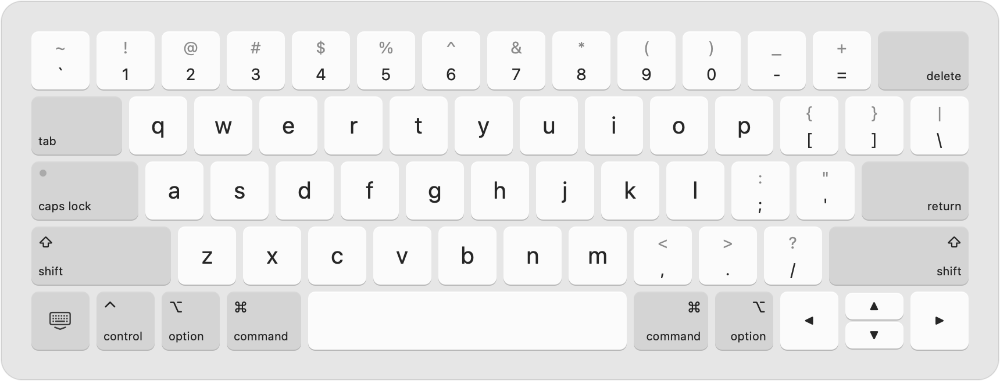
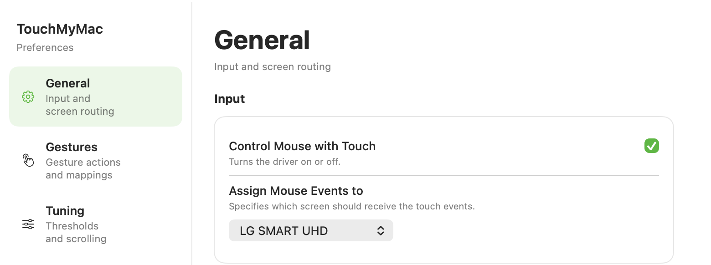

<div align="center">


# TouchMyMac

**Bring iPad-like touchscreen interaction to macOS.**

**English** · [简体中文](README.zh-CN.md)

[](https://github.com/jinghuichen/touchMyMac/releases/latest)
[](https://github.com/jinghuichen/touchMyMac/releases)
[](#-install)
[](#-install)
[](LICENSE)
[](https://github.com/jinghuichen/touchMyMac/stargazers)
[](https://github.com/jinghuichen/touchMyMac/commits/main)

[**Download**](https://github.com/jinghuichen/touchMyMac/releases/latest) · [Gestures](#-gestures) · [Install](#-install) · [FAQ](#-faq) · [Build](#-build-from-source)

</div>

TouchMyMac turns an external USB touchscreen into a real macOS input device. It reads raw HID touch data in user space and turns it into clicks, scrolling with inertia, dragging, multi-finger gestures, shortcut triggers and an on-screen keyboard, so the display feels less like a mouse emulator and more like an iPad.

<picture>
  <source media="(prefers-color-scheme: dark)" srcset="docs/images/keyboard-dark.png">
  
</picture>

## ✨ Highlights

| | |
|---|---|
| 👆 **Direct touch** | Tap to click, drag to scroll, hold and move to drag, two-finger tap for a secondary click. |
| 🌀 **Trackpad-like scrolling** | Scrolling follows the display's refresh rate, filters out touch jitter and hands over to inertia without a pause. |
| ⌨️ **Floating keyboard** | A full Mac layout whose keys fire on touch down, so fast, overlapping typing doesn't drop letters. |
| 🖐 **Multi-finger gestures** | Mission Control, show or hide the keyboard, and configurable shortcuts on four- and five-finger gestures. |
| 🩺 **Diagnostics** | Live connection state, touch counters and a gesture stream to tune noisy panels. |
| 🔒 **User space only** | No kernel extension or driver install: one app, one Accessibility permission. |

## 🖐 Gestures

| Gesture | Action |
|---|---|
| Tap | Click (tap twice to double-click) |
| Drag with one finger | Scroll, with inertia when you flick |
| Hold briefly, then move | Drag (select text, move windows and files) |
| Tap with two fingers | Secondary click, like on a Mac trackpad |
| Pinch with two fingers | Zoom |
| Swipe up with three fingers | Mission Control |
| Swipe up / down with four fingers | Show / hide the floating keyboard |
| Swipe left with four fingers | Shortcut sequence (default `cmd+a, delete`) |
| Hold five fingers still | Keep a shortcut pressed (default `fn`) |

## ⌨️ Floating keyboard

- Full Mac (US ANSI) layout with the number row, symbols and arrow keys
- Keys fire on touch down, and each finger types its own key, so fast typing doesn't drop letters
- Sticky shift, control, option and command for shortcuts like ⌘C, plus caps lock
- Delete, space and the arrow keys repeat while held
- Floats above every other window; hide it with a four-finger swipe down or the hide key

## 🌀 How scrolling works

Synthesized scroll events are easy to get wrong, so TouchMyMac borrows from how phones and trackpads do it:

- **One step per display frame.** Touch reports (often around 120 Hz) don't line up with display frames, so the finger's path is resampled at each frame instead of posting every report.
- **Jitter filtering.** A One Euro filter smooths heavily at low speed, where touch noise is as large as the movement itself, and barely at high speed, where lag would be noticeable.
- **Release velocity like Android.** A quadratic fit over the last 100 ms, and no fling if the finger had stopped for 40 ms.
- **Continuous handover to inertia.** Inertia starts at the release velocity. If a screen confirms liftoff late, the content keeps gliding instead of pausing.
- **Trackpad scroll phases**, so apps treat the events like trackpad scrolling.

## 📦 Install

1. Download `TouchMyMac-x.y.z-macOS-unsigned.zip` from [**Releases**](https://github.com/jinghuichen/touchMyMac/releases/latest), unzip it and move `TouchMyMac.app` to `/Applications`.
2. Open the app. It isn't notarized, so macOS blocks the first launch: open **System Settings → Privacy & Security** and click **Open Anyway**.
3. Grant **Accessibility** access when asked (System Settings → Privacy & Security → Accessibility). TouchMyMac needs it to post clicks, scrolling and key presses.
4. Connect your touchscreen and, if you have several displays, choose it under **Settings → General → Assign Mouse Events to**.

> [!IMPORTANT]
> Release builds are ad-hoc signed, so macOS treats every update as a new app. After updating, **remove TouchMyMac from the Accessibility list and add it again**. Otherwise touches do nothing even though the switch looks on.

> [!NOTE]
> The release zip is built for Apple silicon. Intel Macs can [build from source](#-build-from-source), but that is untested.

## ⚙️ Settings

Everything below lives in the Settings window (menu bar icon → Settings).

| Setting | Default | What it does |
|---|---|---|
| Hold Duration | 0.1 s | How long to hold still before moving turns into a drag instead of a scroll |
| Scroll Speed | 1.0 | Content movement per finger movement; 1.0 keeps the content under your finger |
| Scroll Inertia | On | Keep scrolling after a flick |
| Decay Speed | 0.92 | How quickly inertia slows down (higher glides longer) |
| Inertia Amount | 1.0 | How far inertia glides |
| Double Click Zone | 8 mm | How close two taps must be to count as a double click |
| Error Resistance | 4 | Reports to wait before dropping a touch on panels that lose contacts |
| Ignore Origin Touches | On | Ignore bogus touches at (0, 0) that some panels send |
| Secondary Click / Magnification / Mission Control / Keyboard | On | Turn individual gestures on or off |
| Five-Finger Hold Shortcut | `fn` | Chord held while five fingers rest on the screen |
| Four-Finger Left Swipe Sequence | `cmd+a, delete` | Shortcuts fired by a four-finger left swipe |

<picture>
  <source media="(prefers-color-scheme: dark)" srcset="docs/images/settings-dark.png">
  
</picture>

## 🖥 Tested hardware

| Display | Status |
|---|---|
| LG Smart Monitor Swing | ✅ Tested by this fork |
| Other USB HID touchscreens | ❔ Should work if they work on Windows without a driver; not validated yet |

Have it working on another screen? Open an issue or PR to add it here.

## ❓ FAQ

<details>
<summary><b>Touches do nothing after installing or updating</b></summary>

Accessibility access is missing or stale. Remove TouchMyMac from System Settings → Privacy & Security → Accessibility, add `/Applications/TouchMyMac.app` again, then quit and reopen the app.
</details>

<details>
<summary><b>macOS says the app is damaged or can't be opened</b></summary>

The build isn't notarized. Use **Open Anyway** in System Settings → Privacy & Security. If macOS still refuses, clear the download quarantine flag:

```bash
xattr -dr com.apple.quarantine /Applications/TouchMyMac.app
```
</details>

<details>
<summary><b>Dragging selects or moves things when I meant to scroll</b></summary>

Pausing longer than the Hold Duration before you move starts a drag. Start moving sooner, or raise Hold Duration in Settings → Tuning.
</details>

<details>
<summary><b>Touches land on the wrong display</b></summary>

Pick the touchscreen under Settings → General → Assign Mouse Events to. TouchMyMac remembers the choice.
</details>

<details>
<summary><b>Input is jumpy or touches get stuck</b></summary>

Raise Error Resistance and keep Ignore Origin Touches on. The Diagnostics pane shows live touch counts and the recognized gestures, which helps narrow it down.
</details>

## 🛠 Build from source

```bash
git clone https://github.com/jinghuichen/touchMyMac.git
cd touchMyMac
open TouchMyMac.xcodeproj
```

Or build, install to `/Applications` and launch in one step:

```bash
scripts/build_install_run.sh
```

Requires Xcode and macOS 12 or later.

## 🗂 Project structure

```
TouchMyMac/   App: settings UI, menu bar item, diagnostics, floating keyboard
Core/         TouchUpCore: HID parsing, touch tracking, gestures, event posting
scripts/      Build-and-install helper
docs/         README images
```

## 🧭 Roadmap

- [x] Floating keyboard with a full Mac layout
- [x] Two-finger tap for secondary click
- [x] Display-synced, jitter-filtered scrolling with continuous inertia
- [ ] Trackpad gesture events, for swipe navigation and edge bounce in more apps
- [ ] Scrolling on a dedicated thread, so a busy main thread can't drop frames
- [ ] Signed and notarized releases

## 🙏 Acknowledgements

TouchMyMac builds on the original TouchMyMac and TouchUpCore by [Sebastian Hueber](https://hci.rwth-aachen.de/touchup) (RWTH Aachen). This fork keeps that foundation and adds the gesture set, shortcut mappings, the floating keyboard, the settings UI and the scrolling work.

## 📄 License

[MIT](LICENSE) © 2024 Sebastian Hueber, © 2026 Jinghui Chen

## ⭐ Star history

<a href="https://star-history.com/#jinghuichen/touchMyMac&Date">
  <picture>
    <source media="(prefers-color-scheme: dark)" srcset="https://api.star-history.com/svg?repos=jinghuichen/touchMyMac&type=Date&theme=dark">
    
  </picture>
</a>
